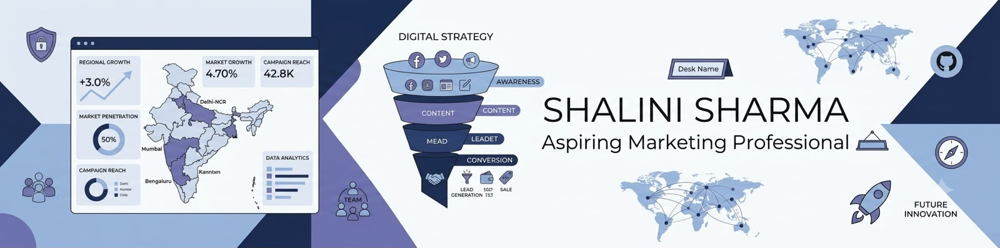

# Hi, I'm Shalini Sharma ⚡


<br>


</div>

---

## 👋 About Me

Hi! I'm **Shalini Sharma**,pursuing a B.A. Programme (**Advertising, Sales Promotion, Sales & Marketing, and Economics**.)

My academic background has helped me understand how businesses communicate with customers, promote products, understand markets, and make business decisions.

I am now exploring **marketing analytics**  I want to understand the data behind marketing and business decisions. I am interested in learning how data can help businesses understand customers, measure marketing performance, identify trends, and make better decisions.

Alongside my studies, I have explored **marketing-related activities, poster designing, blog writing, and video editing**. These experiences have helped me develop creativity, communication, and an understanding of how content can support marketing.

I am currently building my technical skills in **Python, SQL, Power BI, Excel, Statistics, and Machine Learning fundamentals**, with the goal of gaining practical experience through real-world projects and business problems.

---

## 🎯 Career Focus


I want to build a career where I can combine:

**Marketing + Creativity + Business Understanding + Data**

I am particularly interested in understanding customer behaviour, marketing performance, business trends, and how data can support better decision-making.

---

## 📚 Currently Learning

- 🐍 **Python**
- 🗄️ **SQL**
- 📊 **Power BI**
- 📗 **Microsoft Excel**
- 📈 **Statistics**
- 🤖 **Machine Learning Fundamentals**

My focus is on learning these tools and understanding how they can be applied to **real marketing and business problems**.

---

## 🛠️ Tools & Tech

### 📊 Data Analysis


### 📈 Visualization & Business Tools


### 📐 Foundations


### 📣 Marketing & Creative Skills

- Advertising
- Sales Promotion
- Content Writing
- Blog Writing
- Poster Designing
- Video Editing
- Marketing Communication

---

## 🚀 Projects & Case Studies

I am currently building my project portfolio and working towards applying my academic knowledge to practical marketing and business problems.

### 📌 Marketing Analytics Case Study — Coming Soon

**Business Problem →**  
Explore how businesses can use data to understand marketing performance, customer behaviour, and business trends.

**Approach →**  
Analyse relevant business data, identify patterns and trends, create clear visualizations, and convert the findings into simple and useful business insights.

**Tools Used →**  
`Python` `SQL` `Power BI` `Excel` `Statistics`

**Expected Outcome →**  
Develop practical experience in connecting marketing concepts with data-driven business decisions.

> 🚧 More projects and case studies will be added as I complete them.

---

## 📊 GitHub Stats

<div align="center">


</div>

---

## 🌱 My Learning Journey

```text
Advertising & Marketing
          ↓
Business & Economics
          ↓
Creative & Communication Skills
          ↓
Excel & Data Fundamentals
          ↓
Python • SQL • Power BI • Statistics
          ↓
Marketing & Business Analytics
          ↓
Data-Informed Business Decisions
```


